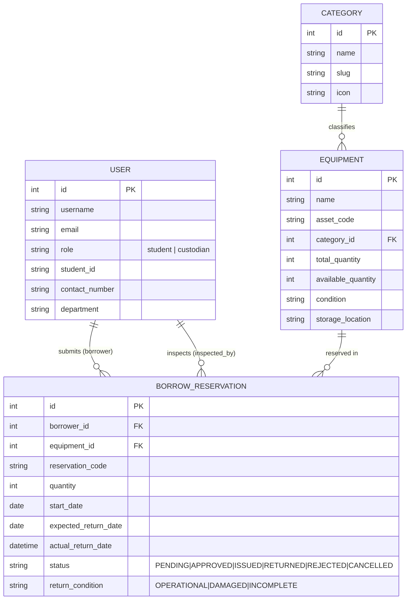

# BorrowTech - University IT Laboratory Equipment Borrowing & Inventory Management System

[](https://www.djangoproject.com/)
[](https://supabase.com/)
[](https://tailwindcss.com/)
[]()

**BorrowTech** is a web-based laboratory equipment borrowing and inventory management platform designed for university IT departments. It replaces manual paper logbooks by enabling IT students to check live hardware availability and submit digital reservations, while giving lab custodians an automated dashboard to manage approvals, track returns, and maintain an accurate asset audit trail.

> **Project Phase:** IM2 Project Development 2 – Core Feature (Vertical Slice)  
> **Repository:** `BorrowTech-Narisma-ElishaMelAltair-G2`  
> **Student:** Elisha Mel Altair Narisma  
> **Section:** G2  

---

## 🌟 Core Feature: Digital Laboratory Equipment Borrowing & Return Lifecycle

The primary capability of BorrowTech is a complete vertical slice of the laboratory borrowing and return lifecycle:
- **Full Working UI:** Users can browse the live hardware catalog, submit digital loan requests, inspect passes, and manage the full handover and return inspection process directly in the web UI.
- **Data Persistence:** All records and transactions are stored in PostgreSQL / Supabase with strict relational integrity (`ForeignKey` to `User` and `Equipment`).
- **Complete CRUD Operations:**
  - **Create:** IT Students submit digital equipment reservations (`/reservations/create/`). Custodians register new laboratory hardware assets (`/equipment/add/`).
  - **Read:** Live equipment catalog with keyword and category search (`/equipment/`), student personal loan history (`/reservations/my/`), digital equipment pass receipt (`/reservations/<id>/`), and custodian master loan queue (`/reservations/queue/`).
  - **Update:** Students can edit their pending reservation requests (`/reservations/<id>/edit/`). Custodians execute workflow state changes: **Approve**, **Reject** with reason, **Handover/Issue** (deducting inventory), and **Process Return** (inspecting hardware condition and restoring inventory).
  - **Delete:** Students can cancel their pending/approved reservations (`/reservations/<id>/cancel/`). Custodians can decommission or delete hardware assets (`/equipment/<id>/delete/`).
- **Business Rule Enforcement:**
  - **Stock Availability:** Requested quantity cannot exceed available inventory units.
  - **Concurrent Loan Limit:** Students are restricted to a maximum of 3 concurrent active or pending equipment items.
  - **Loan Duration:** Enforces a maximum 7-calendar-day borrowing period per university policy.
  - **Cross-User Privacy:** Students can only view, edit, or cancel their own reservations.
  - **Stock Synchronization:** Automated database transaction decrements stock upon hardware handover and restores it upon return inspection.

---

## 🛡️ Standard Features (from Project Development 1)
- **Account Registration:** Full input validation, unique email/username, matching password confirmation, role selection (IT Student vs Lab Custodian), and hashed password storage using Django Auth.
- **Login / Logout:** Supports dual authentication with **Username OR Email**, displays clear error alerts, protects routes via `@login_required`, and cleanly flushes sessions upon sign-out.
- **Role-Based User Dashboards:** Dedicated dashboards for IT Students (`/dashboard/student/`) and Laboratory Custodians (`/dashboard/custodian/`) with custom authorization decorators (`@student_required`, `@custodian_required`) blocking cross-role URL tampering.
- **User Profile Management:** View personal account details, update information, and upload custom profile photos (`/profile/`).

---

## 🏗️ Relational Data Models



---

## 🌿 Git Branching Strategy & Workflow

This project adheres to the Gitflow branching strategy with pull request merges:
- **`main`**: Production-ready, stable releases only. Direct commits prohibited.
- **`develop`**: Central integration branch.
- **`feature/<name>`**: Individual feature branches merged into `develop` via non-fast-forward merge commits (`--no-ff`).

| Branch | Merged Into | PR Merge Commit | Features Included |
| :--- | :--- | :--- | :--- |
| **`feature/equipment-inventory`** | `develop` | `Merge pull request #1` | Equipment and Category data models, stock management, live catalog, and CRUD templates. |
| **`feature/borrowing-reservations`** | `develop` | `Merge pull request #2` | End-to-end borrowing reservation flow, custodian approval queue, handover stock deduction, and return inspection. |
| **`develop`** | `main` | `Merge pull request #3` | Project Development 2 Core Feature increment release and documentation. |

---

## ⚙️ Setup & Installation Guide

### 1. Clone the Repository
```bash
git clone https://github.com/ElishaMelAltairNarisma/BorrowTech-Narisma-ElishaMelAltair-G2.git
cd BorrowTech-Narisma-ElishaMelAltair-G2
```

### 2. Set Up Virtual Environment
```bash
# Windows
python -m venv venv
.\venv\Scripts\activate

# macOS / Linux
python3 -m venv venv
source venv/bin/activate
```

### 3. Install Dependencies
```bash
pip install -r requirements.txt
```

### 4. Configure Database (`.env`)
Create a `.env` file based on `.env.example`:
```bash
cp .env.example .env
```
Set your PostgreSQL or Supabase URI:
```env
SECRET_KEY=your-django-secret-key-here
DEBUG=True
ALLOWED_HOSTS=localhost,127.0.0.1,0.0.0.0
DATABASE_URL=postgresql://postgres:[PASSWORD]@[HOST]:[PORT]/[DATABASE]?sslmode=require
```

### 5. Run Migrations & Seed Demo Data
```bash
python manage.py migrate
python manage.py seed_borrowtech
```

### 6. Start the Server
```bash
python manage.py runserver
```
Navigate to `http://127.0.0.1:8000/`.

---

## 🔑 Demo Test Accounts

| Role | Username | Password | Purpose |
| :--- | :--- | :--- | :--- |
| **IT Student** | `it_student` | `StudentPass2026!` | Browse hardware catalog, submit digital reservations, view personal loans |
| **Lab Custodian** | `lab_custodian` | `CustodianPass2026!` | Approve/reject requests, issue equipment handovers, inspect returns |
| **Superuser (Admin)** | `admin` | `AdminPass2026!` | Administrative management via Django admin (`/admin/`) |

---

## 🧪 Automated Testing (35 Tests Passing)

Execute the full automated test suite covering authentication, equipment inventory, and borrowing workflows:
```bash
python manage.py test
```

Expected output:
```text
Creating test database for alias 'default'...
...................................
----------------------------------------------------------------------
Ran 35 tests in 1.45s

OK
```

---

## 📄 Implementation Report
The official completion report is available in the repository at:  
[`docs/BorrowTech-Narisma-ElishaMelAltair-G2-PD2.pdf`](docs/BorrowTech-Narisma-ElishaMelAltair-G2-PD2.pdf)
